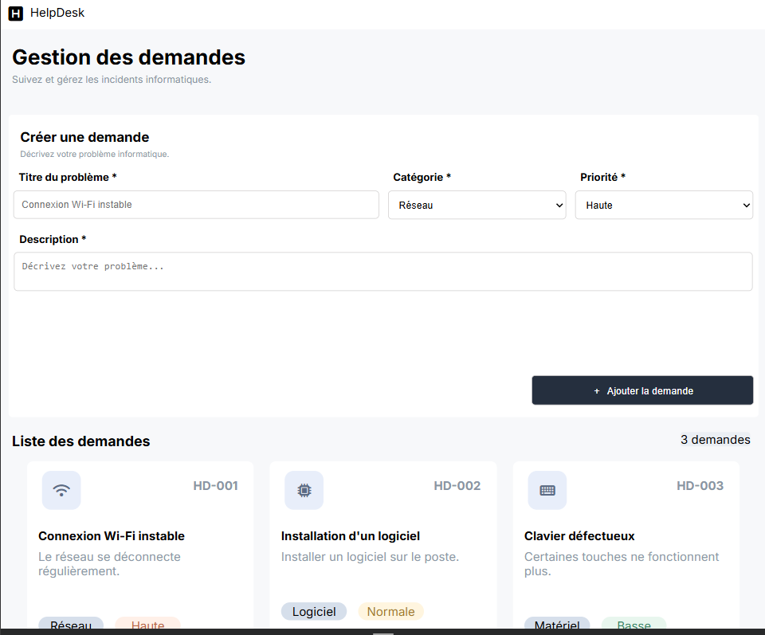

# Help-Desk
# HelpDesk



HelpDesk est une application web interactive de gestion des demandes de support
informatique, réalisée pour Atlas Solutions, une entreprise fictive de services
numériques. Elle permet de consulter, ajouter et supprimer des demandes
directement dans le navigateur, sans backend ni base de données.

## Fonctionnalités

- Affichage dynamique des demandes sous forme de cartes (titre, catégorie, priorité)
- Ajout d'une demande avec un formulaire dont tous les champs sont obligatoires
- Validation des champs : un message d'erreur rouge s'affiche sous chaque champ vide
- Message de confirmation après l'ajout d'une demande
- Suppression d'une demande avec confirmation
- Compteur dynamique du nombre total de demandes
- Message adapté lorsqu'aucune demande n'existe
- Interface responsive : mobile, tablette et desktop

## Technologies utilisées

- HTML5 sémantique
- CSS3 (Flexbox, Grid, media queries)
- JavaScript Vanilla (DOM, événements, tableaux d'objets)
- Git, GitHub, Jira

## Structure du projet

```
Help-Desk/
├── index.html
├── css/
│   ├── style.css
│   └── responsive.css
├── js/
│   └── scripte.js
├── assets/
│   └── images/
└── README.md
```

## Workflow Git

- `main` : branche stable, contient la dernière version complète du projet
- `develop` : branche d'intégration, on y fusionne les fonctionnalités avant de passer sur `main`
- `feat/formulaire` : branche de travail pour le formulaire et les fonctionnalités

## Gestion de projet

Le suivi des user stories et des tâches techniques est réalisé avec Jira.

## Démo en ligne

🔗 https://redabou-dev.github.io/Help-Desk/